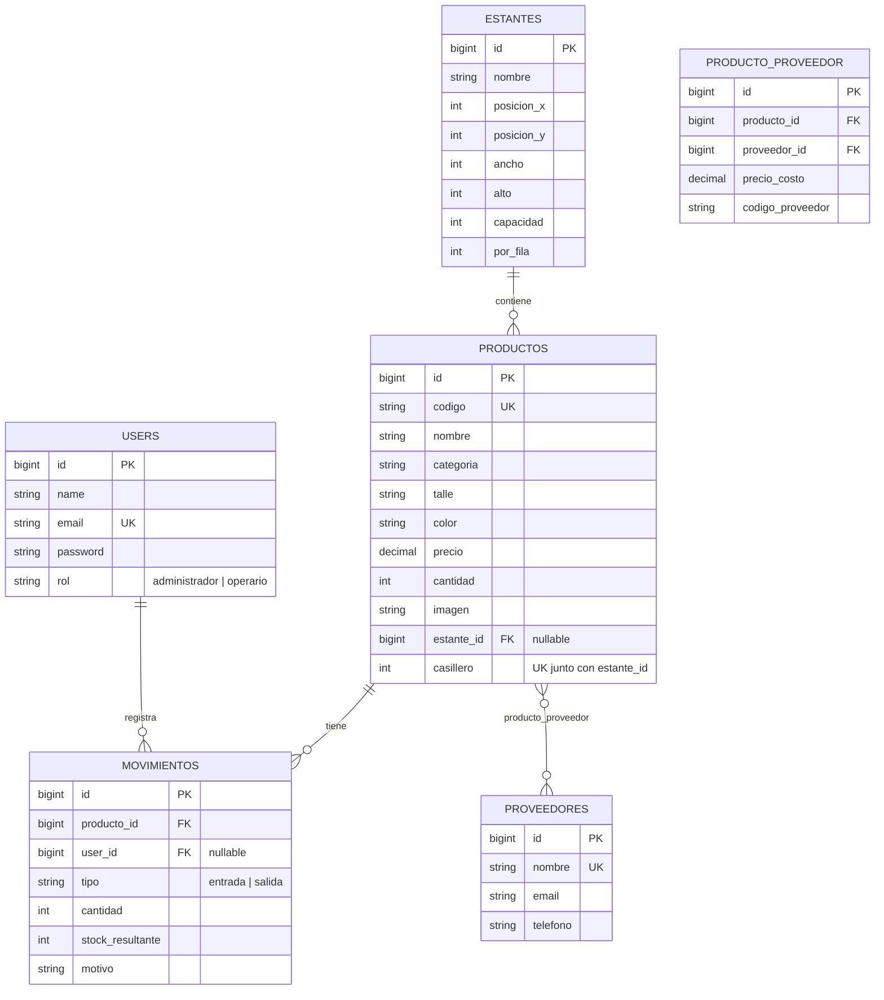

# Almacén Ropa — Sistema de gestión de almacén en 3D

Trabajo Final Integrador · Programación Web Dinámica · Tecnicatura Superior en Desarrollo Web (UNCo)

---

## 1. Nombre y descripción de la aplicación

**Almacén Ropa** es un sistema web de gestión del almacén de un local de ropa, desarrollado con **Laravel** siguiendo el patrón **MVC**.

El problema que resuelve: un local necesita saber **qué prendas tiene, cuántas quedan y en qué lugar físico están guardadas**. La aplicación representa el almacén como un **mapa 3D** donde cada estante es un mueble real, dividido en secciones (casilleros), y cada prenda se guarda en una sección concreta. Desde ese mapa se controla el stock, se mueven las prendas, se consultan los proveedores y se audita quién hizo cada movimiento.

> Este repositorio contiene la **versión 3D** (rama `version-3d`). La versión anterior, con un mapa en 2D, se conserva en la rama `main`.

---

## 2. Integrantes del grupo

| Integrante | Rol en el proyecto |
|---|---|
| _Joaquin Cofre_ | _Desarrollador_ |
---

## 3. Funcionalidades implementadas

**Almacén 3D**
- Mapa 3D del almacén con estantes reales (postes, tableros y divisores). Cada prenda se ve dentro de su sección.
- Barra de capacidad sobre cada estante, con el color de su estado (vacío, con espacio, casi lleno, lleno).
- Cámara orbital: girar, acercar y desplazarse. Al abrir un estante, la cámara se acerca de frente y se muestran solo sus prendas.
- Arrastrar una prenda a otra sección del estante (si está ocupada, se intercambian), a otro estante o a la zona "Sin ubicar".
- Modo edición: crear, renombrar, cambiar capacidad y prendas por fila, mover (arrastrando por el piso, pegado a una grilla) y eliminar estantes. No permite que se pisen ni que salgan del mapa.
- Búsqueda por nombre o código y filtro por categoría, con resaltado de las coincidencias.
- **Visor 3D de la prenda**: la prenda se dibuja con volumen, pintada con su color, y se puede ver de frente, de costado y de espalda.

**Gestión de productos y stock**
- Alta, edición y baja de productos, con imagen opcional y código autogenerado si no se indica uno.
- Entradas y salidas de stock. Una salida nunca deja el stock en negativo.
- **Historial de movimientos**: cada entrada o salida queda registrada con la persona que la hizo y el stock resultante. Se puede filtrar por tipo y buscar por prenda.

**Proveedores**
- ABM de proveedores.
- Vinculación de proveedores con productos, con **precio de costo** y **código del proveedor** propios de cada vínculo.

**Seguridad y usuarios**
- Inicio y cierre de sesión, con límite de intentos de ingreso.
- Dos perfiles (administrador y operario) con permisos distintos.

**Panel general**
- Resumen del inventario con un gráfico y la lista de productos con stock bajo.

---

## 4. Modelo de datos y relaciones entre entidades



**Relaciones**

| Relación | Tipo | Implementación en Eloquent |
|---|---|---|
| Estante → Productos | **1:N** | `Estante::productos()` (`hasMany`) y `Producto::estante()` (`belongsTo`) |
| Producto ↔ Proveedor | **N:M** con tabla intermedia `producto_proveedor` (con datos propios: `precio_costo`, `codigo_proveedor`) | `belongsToMany` + `withPivot()` + `withTimestamps()`, con `attach()` y `detach()` |
| Producto → Movimientos | **1:N** | `Producto::movimientos()` (`hasMany`) |
| Usuario → Movimientos | **1:N** | `User::movimientos()` (`hasMany`) y `Movimiento::usuario()` (`belongsTo`) |

**Restricciones destacadas**
- `productos`: la combinación `(estante_id, casillero)` es única: dos prendas no pueden ocupar la misma sección.
- `producto_proveedor`: la combinación `(producto_id, proveedor_id)` es única y se borra en cascada.
- `movimientos`: se borra en cascada si se elimina la prenda; si se elimina el usuario, el historial se conserva.

---

## 5. Perfiles de usuario y permisos

| Acción | Administrador | Operario |
|---|:---:|:---:|
| Ver el mapa 3D, el panel general y el historial de movimientos | ✅ | ✅ |
| Ver la ficha de una prenda, sus proveedores y el visor 3D | ✅ | ✅ |
| Sumar o restar stock | ✅ | ✅ |
| Mover prendas entre estantes y casilleros | ✅ | ✅ |
| Crear, editar y eliminar productos | ✅ | ❌ |
| Crear, editar, mover y eliminar estantes (modo edición) | ✅ | ❌ |
| ABM de proveedores | ✅ | ❌ |
| Vincular y desvincular proveedores de un producto | ✅ | ❌ |

**Cómo se aplican los permisos (tres capas)**
1. **Middleware `auth`** en todas las rutas: sin sesión se redirige a `/login`.
2. **Middleware propio `rol`** (`App\Http\Middleware\VerificarRol`, alias registrado en `bootstrap/app.php`): las rutas de administración usan `rol:administrador` y responden **403** a cualquier otro perfil, aunque la petición se arme a mano.
3. **Gate `administrar`** (definido en `AppServiceProvider`): las vistas Blade ocultan los botones con `@can('administrar')`.

**Usuarios de prueba** (cargados por el seeder)

| Perfil | Email | Contraseña |
|---|---|---|
| Administrador | `admin@almacen.test` | `password` |
| Operario | `operario@almacen.test` | `password` |

---

## 6. Descripción de la funcionalidad AJAX

Toda la página del almacén funciona **sin recargar**. El JavaScript usa **Axios** (que envía el token CSRF en cada petición) contra rutas de Laravel que responden **JSON**. Cuando una acción termina, se dispara un evento (`inventario-actualizado`) y el mapa 3D vuelve a pedir los datos y se redibuja solo.

| Acción | Método y ruta | Qué hace |
|---|---|---|
| Cargar el almacén | `GET /almacen/estantes` | Estantes con sus prendas y las prendas sin ubicar |
| Sumar / restar stock | `PATCH /productos/{id}/stock` | Actualiza el stock y registra el movimiento (en una transacción) |
| Mover prenda a otro estante o a "Sin ubicar" | `PATCH /productos/{id}/mover` | El servidor elige el primer casillero libre |
| Mover o intercambiar de casillero | `PATCH /productos/{id}/casillero` | Intercambia si el destino está ocupado |
| Ubicar una prenda sin estante | `PATCH /productos/{id}/ubicar` | Valida que el casillero esté libre |
| Crear / editar producto | `POST /productos`, `PATCH /productos/{id}` | Con imagen (`FormData`) y errores de validación por campo |
| Eliminar producto | `DELETE /productos/{id}` | Borra el producto y su imagen |
| Crear / editar / eliminar estante | `POST`, `PATCH`, `DELETE /estantes` | Modo edición |
| Mover un estante | `PATCH /estantes/{id}/geometria` | Valida grilla, límites y que no pise a otro |
| Proveedores de una prenda | `GET /productos/{id}/proveedores` | Lista con precio de costo y código |
| Vincular proveedor (`attach`) | `POST /productos/{id}/proveedores` | Crea el vínculo en la tabla intermedia |
| Desvincular proveedor (`detach`) | `DELETE /productos/{id}/proveedores/{proveedor}` | Quita el vínculo |

**Manejo de errores:** las validaciones devuelven `422` con mensajes en español, que se muestran junto al campo o bajo el mapa. Si el usuario no tiene permiso, el servidor responde `403`.

---

## 7. Librería externa utilizada y justificación

### Three.js (`three`)
**Para qué se usa:** dibujar el almacén en 3D y el visor de prendas.

**Por qué se incorporó:** la versión inicial del sistema mostraba el almacén en 2D (con Konva.js). Representar los estantes como muebles reales, con secciones y prendas guardadas adentro, permite entender de un vistazo **dónde está cada prenda y cuánto espacio queda**, algo que en un plano 2D no se aprecia. Three.js es la librería 3D estándar para la web: funciona sobre WebGL sin plugins, está muy documentada y trae lo necesario:

- `OrbitControls`: girar, acercar y desplazar la cámara.
- `Raycaster`: saber qué objeto está bajo el mouse (selección, tooltip y arrastre de prendas).
- `ExtrudeGeometry`: generar prendas con volumen a partir de una silueta.
- `GLTFLoader`: opcionalmente, cargar modelos `.glb` reales colocados en `public/modelos/`.

### Otras librerías del proyecto
| Librería | Uso |
|---|---|
| **Chart.js** | Gráfico del panel general |
| **Alpine.js** | Estado y comportamiento de la interfaz (ventanas, formularios, filtros) |
| **Axios** | Peticiones AJAX con token CSRF |
| **Tailwind CSS** | Estilos |
| **Vite** | Compilación de los recursos (JS y CSS) |

---

## Instalación y ejecución

**Requisitos:** PHP 8.3 o superior, Composer, Node.js 20 o superior y MySQL (por ejemplo, el de XAMPP).

```bash
# 1. Dependencias
composer install
npm install

# 2. Configuración
cp .env.example .env
php artisan key:generate
```

3. En MySQL (phpMyAdmin) creá una base de datos llamada **`almacen`**. Los datos de conexión están en el `.env` (`DB_DATABASE=almacen`, `DB_USERNAME=root`, sin contraseña).

```bash
# 4. Tablas y datos de prueba
php artisan migrate:fresh --seed

# 5. Recursos y servidor
npm run build
php artisan serve
```

Abrí `http://localhost:8000` e ingresá con alguno de los usuarios de prueba. Para desarrollar con recarga automática, usá `npm run dev` en lugar de `npm run build`.

> Las imágenes de los productos se guardan en `public/imagenes/productos/`. Si una prenda no tiene imagen, se muestra en gris.

## Estructura (MVC)

| Capa | Ubicación |
|---|---|
| **Modelos** | `app/Models`: `Estante`, `Producto`, `Proveedor`, `Movimiento`, `User` |
| **Vistas** | `resources/views`: `almacen`, `panel`, `login`, `proveedores/*`, `movimientos/*` y el layout `layouts/principal` |
| **Controladores** | `app/Http/Controllers`: `AlmacenController`, `ProductoController`, `EstanteController`, `ProveedorController`, `ProductoProveedorController`, `MovimientoController`, `AuthController`, `PanelController` |
| **Validaciones** | `app/Http/Requests`: `GuardarProductoRequest`, `EstanteRequest`, `ProveedorRequest` |
| **Middleware** | `app/Http/Middleware/VerificarRol.php` |
| **JavaScript** | `resources/js/almacen`: `mapa3d.js` (escena 3D), `visor3d.js` (visor de prendas), `pagina.js` (estado de la interfaz) |
| **Base de datos** | `database/migrations` y `database/seeders` |
